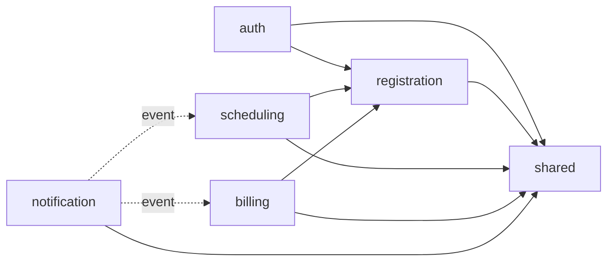
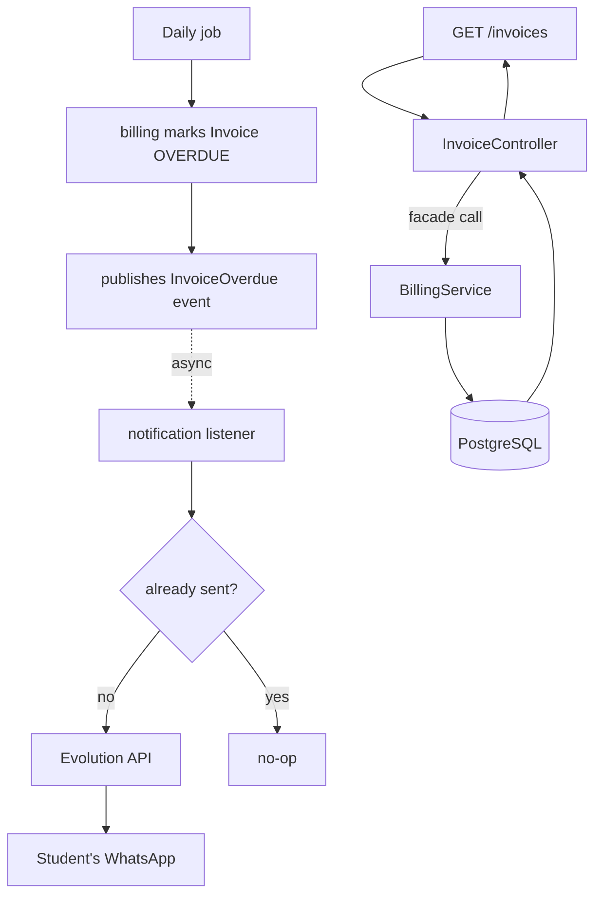

# Tonus

Management system for schools and studios with three user roles — **admin**,
**teacher**, and **student**. Handles people registration, class scheduling,
billing, and WhatsApp notifications.

Two parts in this repo: an API in `backend/` and a SPA in `frontend/`.

## Architecture

A modular monolith (Spring Modulith), not microservices: one deployable, but
module boundaries are enforced at test time so it can't quietly turn into a
big ball of mud.

| Module | Responsibility |
|---|---|
| `shared` | Cross-cutting infra: errors, `Clock`, audit, Jackson config |
| `auth` | Login, JWT cookie, refresh tokens |
| `registration` | Students and teachers |
| `scheduling` | Classes, default schedules, announcements |
| `billing` | Plans, invoices, payments |
| `notification` | WhatsApp notifications |



Solid arrows are direct calls (facade); dashed arrows are event listeners.
`notification` only reacts to events from `scheduling` and `billing` — it
never calls into them directly. This graph is enforced by
`ApplicationModules.verify()`: a new dependency has to be added explicitly
in `@ApplicationModule(allowedDependencies)`, so it can't sneak in.

Here's what that split looks like end-to-end — a daily job flags an invoice
as overdue, and a student query reads that same data back:



The event path is async and at-least-once, so the listener checks
`notification_log` before sending — that's what turns a redelivery into a
no-op instead of a duplicate WhatsApp message. The query path is a plain
synchronous read, same transaction start to finish.

A couple more decisions worth knowing:

- **Authorization lives only in `SecurityConfig`**, as per-route rules —
  never `@PreAuthorize` in a controller. One place to check who can do what,
  instead of trusting that every controller remembered to lock itself down.
- **Frontend and API are same-origin**, so there's no CORS to configure. The
  session lives in an `httpOnly` cookie; the frontend never touches a token.

More detail — event contracts, DDL, the reasoning behind each call — lives
in `docs/`.

## Stack

**Backend** — Java 25, Spring Boot 4 (Web MVC, Data JPA, Security), Spring
Modulith, PostgreSQL, Flyway, Testcontainers, ShedLock, JWT (jjwt), Bucket4j,
Maven.

**Frontend** — Vite, React 18, TypeScript, React Router, TanStack Query,
react-hook-form + zod, Tailwind, Vitest + RTL + MSW.

## API

Errors follow RFC 9457 Problem Details. Unauthenticated is `401`,
authenticated without permission is `403`.

**`auth`**

| Method | Route | Who | What it does |
|---|---|---|---|
| `POST` | `/auth/login` | public | logs in, sets the session cookie |
| `POST` | `/auth/refresh` | public (cookie) | rotates the refresh token |
| `POST` | `/auth/logout` | public (cookie) | ends the session |
| `GET` | `/auth/me` | authenticated | who's logged in |
| `POST` `GET` | `/users` | ADMIN | create/list logins |
| `PATCH` | `/users/{id}/activate` | ADMIN | reactivate a revoked login |

**`registration`** (ADMIN only)

| Method | Route | What it does |
|---|---|---|
| `POST` `GET` `GET /{id}` `PUT /{id}` | `/students` | student CRUD |
| `PATCH /{id}/activate` `.../deactivate` | `/students` | never DELETE |
| `POST` `GET` `GET /{id}` `PUT /{id}` | `/teachers` | teacher CRUD |
| `PATCH /{id}/activate` `.../deactivate` | `/teachers` | same idea |

**`scheduling`**

| Method | Route | Who | What it does |
|---|---|---|---|
| `GET` | `/schedule/day` | ADMIN | a day's schedule, by time and teacher |
| `POST` `GET` `GET /{id}` `PUT /{id}` `DELETE /{id}` | `/default-schedules` | ADMIN | weekly recurring schedule |
| `GET` | `/default-schedules/by-student` | ADMIN | one student's schedule |
| `POST` `GET` `GET /{id}` `DELETE /{id}` | `/schedule-exceptions` | ADMIN | one-off cancel/reschedule |
| `POST` `GET` `DELETE /{id}` | `/announcements` | ADMIN | may suspend classes |
| `POST` | `/announcements/broadcast` | ADMIN | send it now |
| `GET` | `/me/schedule`, `/me/schedule/week` | STUDENT | own schedule |
| `GET` | `/me/grid` | TEACHER | own grid |

**`billing`**

| Method | Route | Who | What it does |
|---|---|---|---|
| `POST` `GET` `GET /{id}` `PUT /{id}` | `/plans` | ADMIN | plan CRUD |
| `PATCH /{id}/activate` `.../deactivate` | `/plans` | ADMIN | toggle a plan |
| `POST` `GET` | `/plan-enrollments` | ADMIN | enroll a student |
| `PATCH /{id}/activate` `.../deactivate` | `/plan-enrollments` | ADMIN | toggle an enrollment |
| `GET` | `/invoices` | ADMIN | listing |
| `GET` | `/invoices/overdue-student-ids` | ADMIN | who's behind |
| `POST` | `/invoices/{id}/payment` | ADMIN | record a payment |
| `GET` | `/me/invoices` | STUDENT | own invoices |

`notification` listens for events and talks to WhatsApp (Evolution API). Since
SPEC-013 it also exposes the gateway's administration to the ADMIN:

| Method | Route | Who | What it does |
|---|---|---|---|
| `GET` | `/whatsapp/status` | ADMIN | instance, connection state, masked number, version |
| `GET` | `/whatsapp/instances` | ADMIN | instances that exist in the gateway |
| `PUT` | `/whatsapp/settings` | ADMIN | choose the instance and the desired version |
| `POST` `DELETE` | `/whatsapp/session` | ADMIN | pair (QR code) and disconnect |

## Running locally

Prerequisites: Java 25, Node 20+, Docker running. Maven wrapper is already
in the repo, no install needed.

```bash
# API on localhost:8080
cd backend
cp .env.example .env
docker compose up -d db
./mvnw spring-boot:run
```

```bash
# SPA on localhost:5173, proxying /api to the API above
cd frontend
npm install
npm run dev
```

Nothing to configure for the session cookie: its `Secure` attribute follows
the actual request transport, not an environment flag. Local is plain HTTP
so it's dropped; behind Caddy in production it's HTTPS so it's set. One
gotcha to know about: Safari refuses `Secure` cookies over HTTP even on
`localhost` (Chrome and Firefox don't), so a `200` on `/auth/login` followed
by a `401` on `/auth/me` in Safari means this, not a bug.

### WhatsApp (optional)

Not needed for day-to-day development: with `NOTIFICATION_ENABLED=false`
notices go to the log and nobody's phone rings. Only worth doing when you
need to see a real message go out.

```bash
cd backend
# Fill EVOLUTION_API_KEY in .env first: openssl rand -hex 32
docker compose --profile whatsapp up -d
```

Evolution is published on **`127.0.0.1:8081`** — 8081 because the API already
owns 8080, loopback because whoever reaches it can send messages as the studio.

Pairing is done in Tônus itself, at **`/admin/whatsapp`** (SPEC-013/014): pick
the instance, read the QR code, scan it with the studio's phone. It shows up
under *WhatsApp → Linked devices* as "Tonus". Nobody needs the gateway's API key
to change the studio's WhatsApp number.

The Evolution Manager at <http://localhost:8081/manager> — log in with
`EVOLUTION_API_KEY` — is still there for what the product's own screen does not
cover, like deleting an instance.

Only then, to actually send: set `NOTIFICATION_ENABLED=true` in `.env` and
restart the app. Both sides read that same file — Compose natively, the app
through `spring.config.import` — so there's one place to edit and no way for
the two to disagree about the API key. Real environment variables still win
over it, which is how production stays env-only.

If the QR code never connects (405, or "connection failure" in the Evolution
log), the usual cause is a stale `WHATSAPP_VERSION`: bump it in `.env` to the
value in [`baileys-version.json`](https://github.com/WhiskeySockets/Baileys/blob/master/src/Defaults/baileys-version.json)
and recreate the container.

## Development users

The first login can't come from the API itself — creating a user requires an
already-logged-in ADMIN. Once Postgres is up and the app has run at least
once (migrations applied), this seed gives everyone in the database a login
with the same password:

```bash
cd backend
docker compose exec -T db psql -U tonus -d tonus < scripts/seed-dev.sql
```

Password for everyone: **`tonus123`**. On a fresh database it also creates
a full cast so all three roles have something to log into:

| Login | Role | Person |
|---|---|---|
| `admin@tonus.com` | ADMIN | — |
| `marina@tonus.com` | TEACHER | Marina Duarte |
| `rafael@tonus.com` | TEACHER | Rafael Moreira |
| `beatriz@tonus.com` | STUDENT | Beatriz Lima (Marina) |
| `carla@tonus.com` | STUDENT | Carla Nunes (Marina) |
| `diego@tonus.com` | STUDENT | Diego Alves (Rafael) |
| `helena@tonus.com` | STUDENT | Helena Castro (Rafael) |

(Sofia Ramos is also seeded, inactive and with no login — she's there so the
"Inactive" filter has something to show.)

Run it again any time: it's idempotent, only touches accounts that need it,
and once real people exist in `teacher`/`student` it stops inventing new
ones — it just grants logins to whoever's actually there
(`firstname@tonus.com`). It also leaves each screen with realistic data
(schedules, announcements, plans, a couple of invoices, one overdue) so
nothing renders empty on a fresh clone — but it won't touch a database that
already has real activity in it.

## Running the tests

```bash
cd backend && ./mvnw clean verify    # integration tests, real Postgres via Testcontainers — Docker must be running
```

```bash
cd frontend && npm run test:run && npm run typecheck   # Vitest + RTL, API mocked at the HTTP boundary with MSW
```

H2 is never used for backend tests — database constraints are business
rules and need a real Postgres to verify.

## Module diagrams

The same `allowedDependencies` that architecture tests enforce also
generates PlantUML diagrams, so they can't drift from the code:

```bash
cd backend && ./mvnw test -Dtest=ApplicationModulesDocumentationTest
```

Output goes to `backend/target/spring-modulith-docs/` — `components.puml`
for the full picture, `module-<name>.puml` per module. Paste into
[plantuml.com/plantuml](https://www.plantuml.com/plantuml) or open with your
IDE's PlantUML plugin to view.

## Repository layout

```
backend/    # Java code, pom.xml, migrations, tests, docker-compose
frontend/   # SPA (Vite + React + TypeScript)
docs/       # architecture decisions
CLAUDE.md   # project conventions
```

`frontend/CLAUDE.md` has SPA-specific conventions where they diverge from
the root one.

## Development workflow

TDD with a manual gate: every feature starts in a **RED** phase (failing
acceptance tests, then the minimum code to pass them), and only moves to
**IMPLEMENT** — edge cases, polish, everything else — once explicitly
approved. Details in `CLAUDE.md`.

## Current status

Backend and frontend are complete through the day-schedule screen:

- **Foundation** (`shared` + `auth`) — JWT in an httpOnly cookie, refresh
  rotation with reuse detection, login rate limiting, automatic audit
  logging.
- **`registration`** — student/teacher CRUD, deactivate instead of delete,
  paginated listings, access revoked automatically when someone is
  deactivated.
- **`scheduling`** — recurring weekly schedule, one-off exceptions
  (cancel/reschedule), announcements that can suspend classes. A day's
  schedule is computed on read, never stored.
- **`billing`** — plan → invoice → payment, with a daily job (ShedLock) that
  generates invoices and flags overdue ones. Due day is fixed to enrollment
  day. Multiple plans roll up into one invoice per month, with a discount
  from the second plan on.
- **`notification`** — the only module that talks to the outside world.
  Listens for six event types, notifies students over WhatsApp, and dedupes
  via a unique constraint so retries can't double-send.
- **Frontend foundation** — full session lifecycle (login, transparent
  refresh, logout, reload recovery), role-based navigation shell.
- **Day schedule** — the admin's main screen: a day's classes grouped by
  time and teacher, with cancel/reschedule/undo.

Out of scope for now: self-registration, password recovery, weekly view,
drag-and-drop scheduling.
